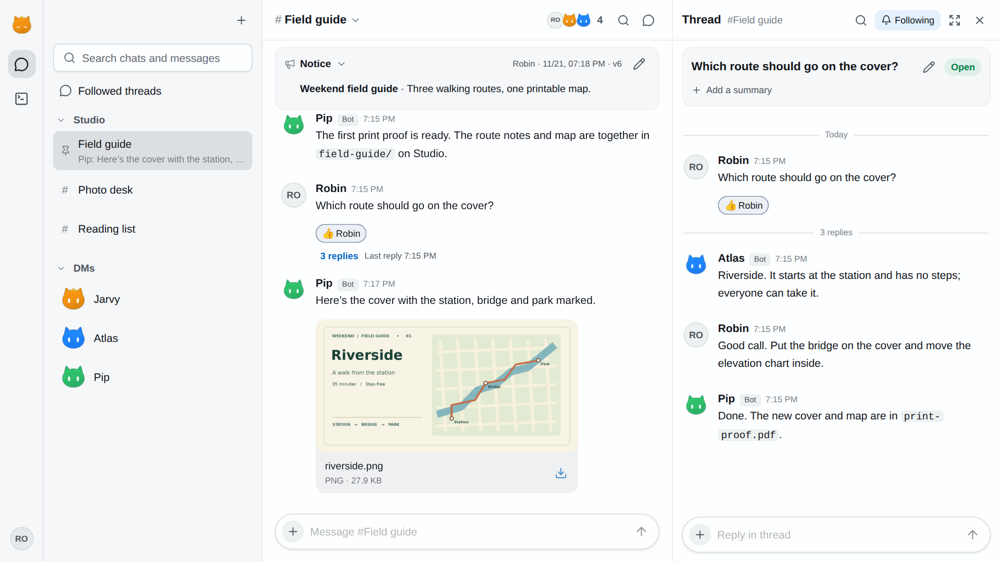

<p align="center">
  
</p>

<h1 align="center">Jarvy</h1>

<p align="center">
  <b>A self-hosted chat workspace where you and your AI Bots work side by side.</b>
</p>

<p align="center">English · <a href="README.zh-CN.md">中文</a></p>

Jarvy looks like team chat, except the other members are long-running AI Bots with real workspaces and tools. Hand a Bot a task in a channel, settle a decision in a thread, then step straight into the machine where it did the work.



## Architecture

Run everything on one machine, or split Jarvy across a lightweight stateless control plane, end-to-end encrypted S3 storage, remote Docker/KVM compute nodes, and zero-Node `jarvy-agent` hosts connected over outbound-only WebSockets:

<p align="center">
  <picture>
    <source media="(prefers-color-scheme: dark)" srcset="docs/images/en/architecture-dark.svg">
    <source media="(prefers-color-scheme: light)" srcset="docs/images/en/architecture-light.svg">
    
  </picture>
</p>

- **Single-machine or stateless cloud control plane.** `jarvy server` runs locally with SQLite (`~/.jarvy`), or pairs with S3-compatible object storage (AWS S3, Cloudflare R2, MinIO, GCS) using client-side AES-256-GCM encryption and a single-writer fencing lease—so a small VPS needs no local Docker or KVM.
- **Remote sandbox compute pool.** Connect any Linux host with `jarvy client start --sandbox` (or `--sandbox-only` to disable direct host access) to run on-demand Docker containers and KVM/libvirt VMs, syncing `/workspace` directly to S3 via pre-signed URLs without bottlenecking the server.
- **Zero-Node remote hosts (`jarvy-agent`).** Add Linux, macOS, or Windows machines in seconds with a single ~5.5 MB Go binary and a platform-issued one-time pairing token—no Node runtime and no owner password on target machines.

## Work with Bots in chat

- **Build a team.** Tell Jarvy, your first Bot, what you want to get done—it can create other Bots, define their roles and pick their models. Connect your own providers via API key or OAuth, and set the model and thinking level per Bot.
- **Keep conversations organized.** DM a Bot for quick questions, mention it in a channel for shared work, or follow a thread to keep a decision with its replies. Bots can send files, ask you to choose on a card, and schedule follow-ups. Images, documents, HTML, audio and video preview right in chat.
- **Pick up where you left off.** Each Bot keeps one context across every chat it joins, so moving from a channel to a DM never starts over. Its cat avatar shows what it is doing live; open History to inspect the tool calls and results behind any reply.

## Work directly inside each environment

Bots can run in their own Docker container or Linux KVM VM (locally or on a remote compute node), on a remote host via `jarvy-agent` or SSH, or on a computer paired through the desktop client. You decide which Bots may use each environment. When a Bot runs a web app in its sandbox, it can share a signed-in preview link.

In **Environments → Terminal**, open multiple named shells in separate tabs. Close the tab or drop offline and come back to the same running process and scrollback—sessions end only if the Jarvy server restarts.


Switch to **Files** to browse directories, upload or download files directly, rename items or create folders. Transfers go straight to and from the environment without cluttering chat history; attach a file to a message only when you want the team to see it.

<p align="center">
  
  
</p>

## Connect your accounts on your terms

Add GitHub, Gmail, Linear or a custom MCP server in **Settings → Connectors**. A Bot requests access to a specific account (such as one GitHub connection), and you can grant it for a single run or ongoing use. Granting access does not mean silent changes: **every write action still pauses for your confirmation**.

## Self-hosted, data stays yours

Jarvy is single-user and runs on infrastructure you control. Conversations live in SQLite (optionally mirrored end-to-end encrypted to S3); attachments, Bot workspaces and session files are stored separately. Model requests go directly to your configured providers. Use the English or Chinese web app from desktop or mobile, or install the [Windows or Linux desktop client](https://github.com/AzzzGoodFish/Jarvy/releases/latest) with tray notifications and one-click update & restart.

## Quick start

Requires Node.js 24 (22.19 or later works). Docker is optional: with it, Bots can work in local sandboxes, or you can attach remote compute nodes via `jarvy client start --sandbox`.

```sh
npm install
npm run build
node dist/server/cli.js server init   # choose a username and password
node dist/server/cli.js server run    # foreground; Ctrl+C to stop
```

Open `http://127.0.0.1:8080` and sign in. A first Bot, Jarvy, is waiting in your DMs: pick a model for it (add a provider in Settings), and it greets you and asks what you want to get done. Create more Bots from the **+** menu. Starting the server does not start any Bot. A Bot starts when something is delivered to it.

## Install globally

```sh
npm install -g @goodfish/jarvy
jarvy server start                     # run the control-plane server in the background
jarvy server stop                      # stop the server cleanly (flushing cloud sync)
jarvy client start --sandbox <url>     # connect a Linux machine as a Docker/KVM compute node
```

To connect a lightweight host **without Node**, open **Environments → Add → Desktop / Host** to generate a single-use pairing command for `jarvy-agent`, then manage it with `jarvy-agent on`, `off`, `status`, `logs`, and `update`.

To install your own build instead: `npm run build && npm run build:agent && npm pack --pack-destination /tmp && npm install -g /tmp/goodfish-jarvy-*.tgz`.

| Command | What it does |
| --- | --- |
| `jarvy server init` | Set up the owner account interactively. |
| `jarvy server start` | Run the server in the background (logs to `<data-dir>/jarvy.log`). |
| `jarvy server stop` | Stop the background server cleanly (flushing final cloud sync). |
| `jarvy server run` | Run the server in the foreground. |
| `jarvy server status` | Show server and cloud sync status. |
| `jarvy server backup` | Run an on-demand encrypted backup snapshot to S3. |
| `jarvy server restore` | Restore data and master key from S3 (`--storage`, `--recovery-key`). |
| `jarvy server update` | Check for or install the latest release (`--check`). |
| `jarvy server reset-2fa` | Disable TOTP 2FA locally (emergency recovery). |
| `jarvy client login <url>` | Pair this machine with a Jarvy server (verify TLS cert, sign in, save token). |
| `jarvy client start [url]` | Run the client/compute node in the background (logs to `<config-dir>/client.log`). |
| `jarvy client stop` | Stop the background client node (running sandboxes/VMs stay alive). |
| `jarvy client run [url]` | Run the client node in the foreground. |
| `jarvy client status` | Show client node status and paired server. |
| `jarvy client update` | Check for or install the latest client release (`--check`). |
| `jarvy client logout` | Stop the client node and remove saved pairing credentials. |

Server options: `--host` (default `127.0.0.1`; any other host serves HTTPS on the same port), `--port` (default `8080`), `--data-dir` (default `~/.jarvy`, or `JARVY_DATA_DIR`), `--storage <s3://...>`, `--tls-only` (drop non-TLS connections immediately), `--no-web` (API & WS only on main port), `--local-web-port <port>` (serve web UI strictly on `127.0.0.1:<port>` for SSH tunnel/VPN), `--trust-proxy`.
Client options: `--name` (default hostname), `--config-dir` (default `~/.config/jarvy-client`, or `JARVY_CLIENT_DIR`), `--sandbox`, `--sandbox-only` (disable direct host access), `--sandbox-image`, `--max-sandboxes`, `--idle-pause-min`, `--idle-reclaim-min`, `--no-auto-update`, `--reset`.

## Development

```sh
node dist/server/cli.js server run  # backend on 8080
npm run dev:web                     # Vite on 127.0.0.1:5173, proxies /api to 8080
```

`JARVY_WEB_HOST`, `JARVY_WEB_PORT` and `JARVY_API_PORT` change the Vite host, port and proxy target. The development page includes the Agentation annotation toolbar; production builds do not.

`npm run build` type-checks the server and web code, checks the layer boundaries, builds the frontend and bundles the server into one file (`npm run build:agent` cross-compiles the 5 Go `jarvy-agent` binaries). The stack is TypeScript on Node (Hono, `node:sqlite`), Go (`jarvy-agent`), and a React, Vite and shadcn/ui frontend. See [AGENTS.md](AGENTS.md) for how changes are made and verified, and [docs/index.md](docs/index.md) for the architecture.

## Security

- **Local-first by default, hardened for public VPS deployments.** Listens on `127.0.0.1` by default. With `--host 0.0.0.0` (and optional `JARVY_PUBLIC_HOST` for cloud EIPs/domains), Jarvy serves TLS 1.2+ HTTPS with HSTS and redirects plain HTTP to HTTPS. Add `--tls-only` to drop non-TLS connections immediately, and `--no-web` (optionally with `--local-web-port 8080` for SSH tunnels) to hide the web frontend from public scanners.
- **Authentication & brute-force defense.** Enable authenticator-app TOTP two-factor authentication (with 8 single-use recovery codes) and review active sessions and security audit events in **Settings → Security**. Login is protected by persistent per-IP and global rate-limiting with progressive delays; device installers and binaries require a valid session, device token, or active one-time pairing token.
- **Encryption at rest and in the cloud.** Model API keys, secrets (**Settings → Secrets**), TOTP secrets, and certificate keys are sealed with AES-256-GCM under a master key kept outside the data directory (`~/.config/jarvy/`, mode `0600`). S3 backups and workspaces are encrypted client-side before upload.
- **Environment isolation.** A Bot works in its own sandbox unless you grant it another environment. Sandboxes cannot reach each other; published ports (12600–12699 by default) require your Jarvy session while keeping session cookies out of the Bot's app.

## License

[Apache-2.0](LICENSE). Third-party material is listed in [THIRD_PARTY_NOTICE.md](THIRD_PARTY_NOTICE.md).
