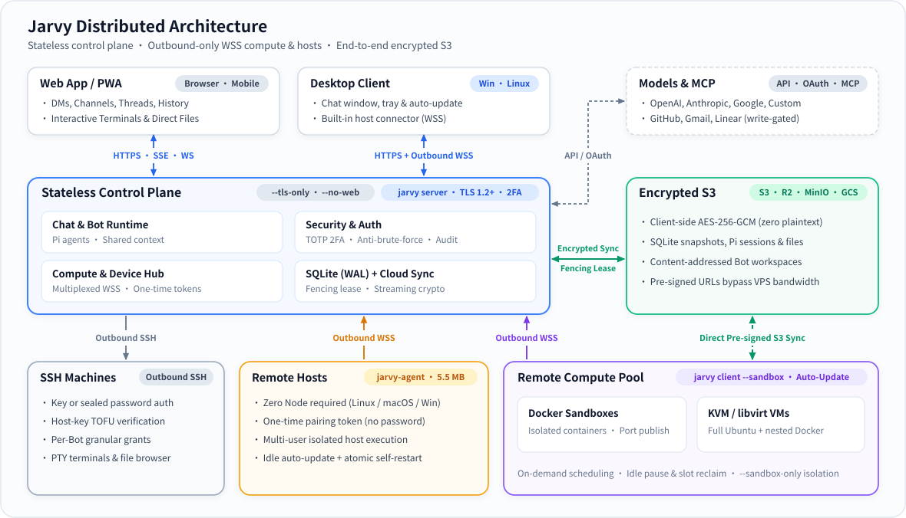
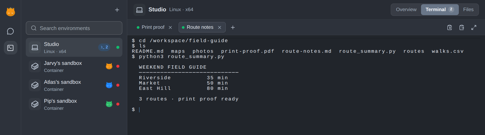
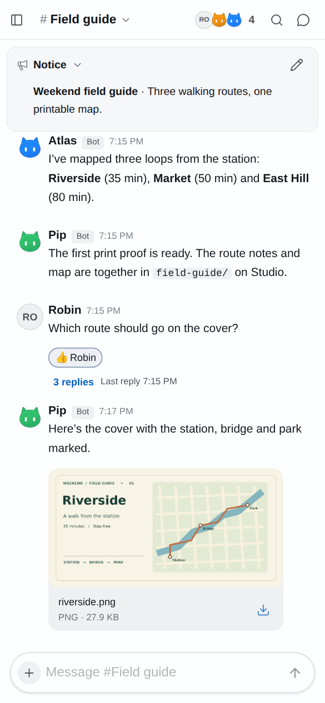
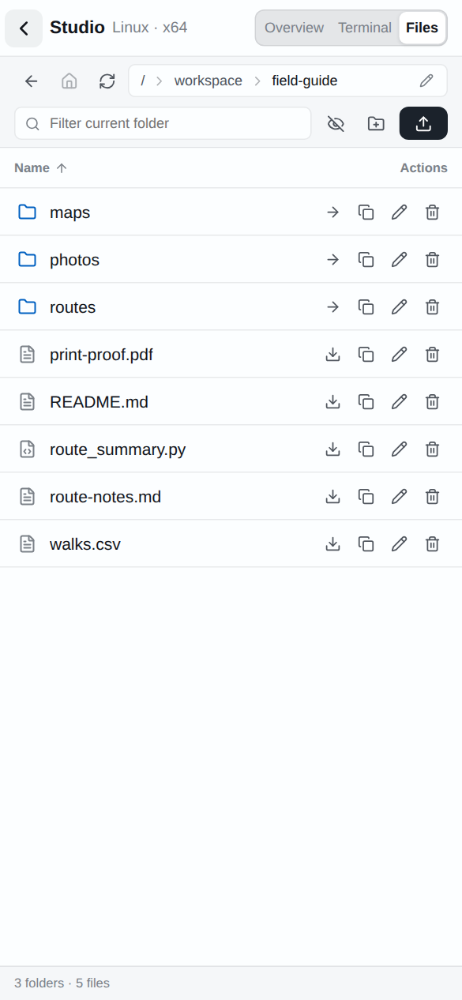

<p align="center">
  
</p>

<h1 align="center">Jarvy</h1>

<p align="center">
  <b>Self-hosted team chat for you and your AI Bots — with real sandboxes, terminals, and encrypted sync.</b>
</p>

<p align="center">
  English · <a href="README.zh-CN.md">中文</a> · <a href="https://github.com/AzzzGoodFish/Jarvy/releases/latest">Desktop App</a> · <a href="docs/index.md">Docs</a>
</p>


## How it works

Run everything on one machine, or split Jarvy across a stateless control plane, remote Docker/KVM compute nodes, zero-Node `jarvy-agent` hosts, and end-to-end encrypted S3:

<p align="center">
  <picture>
    <source media="(prefers-color-scheme: dark)" srcset="docs/images/en/architecture-dark.svg">
    <source media="(prefers-color-scheme: light)" srcset="docs/images/en/architecture-light.svg">
    
  </picture>
</p>

- **Control Plane (`jarvy server`)** — Local SQLite or stateless VPS paired with client-side AES-256-GCM S3 sync & single-writer lease.
- **Compute Pool (`jarvy client --sandbox`)** — Remote Docker containers & KVM VMs over outbound WSS, syncing workspaces directly to S3 via pre-signed URLs.
- **Zero-Node Hosts (`jarvy-agent`)** — ~5.5 MB Go binary for Linux, macOS, and Windows with one-time pairing tokens.

## Highlights

- **Chat with persistent AI Bots** — DMs, channels, threads, shared context per Bot, live activity avatars, choice cards, schedules, and full tool-call History.
- **Step inside every environment** — Persistent multi-tab terminals, direct file browser, signed-in web previews, and per-Bot environment grants.
- **Write-gated Connectors & MCP** — Connect GitHub, Gmail, Linear, or custom MCP servers; **every write action pauses for your confirmation**.
- **Self-hosted & cross-platform** — English/Chinese web & PWA plus [Windows / Linux desktop client](https://github.com/AzzzGoodFish/Jarvy/releases/latest) with tray notifications and live one-click updates.



<p align="center">
  
  
</p>

## Quick Start

Requires Node.js 24 (22.19+ works). Docker is optional.

```sh
npm install -g @goodfish/jarvy
jarvy server init                      # set owner username & password
jarvy server start                     # start control plane (http://127.0.0.1:8080)
jarvy client start --sandbox <url>     # optional: attach a remote Docker/KVM compute node
```

Open `http://127.0.0.1:8080`, add a model provider in **Settings**, and talk to your first Bot (**Jarvy**). To pair a lightweight machine without Node, open **Environments → Add → Desktop / Host** to copy a one-time `jarvy-agent` command.

<details>
<summary><b>CLI Commands & Options</b></summary>

| Command | Description |
| --- | --- |
| `jarvy server init` | Set up the owner account interactively. |
| `jarvy server start` / `stop` / `run` | Run or cleanly stop the server (flushing final cloud sync). |
| `jarvy server status` / `update` | Inspect status/cloud sync or upgrade (`--check`). |
| `jarvy server backup` / `restore` | On-demand encrypted S3 backup or restore (`--storage`, `--recovery-key`). |
| `jarvy server reset-2fa` | Disable TOTP 2FA locally (emergency recovery). |
| `jarvy client login <url>` / `logout` | Pair or unpair a compute node (TLS cert verification + token). |
| `jarvy client start` / `stop` / `run` | Run or stop the compute node (running sandboxes stay alive). |
| `jarvy client status` / `update` | Inspect node status or upgrade (`--check`). |
| `jarvy-agent on` / `off` / `status` / `logs` / `update` | Manage a zero-Node Go host agent. |

**Server flags:** `--host` (default `127.0.0.1`; non-loopback serves HTTPS), `--port` (`8080`), `--data-dir` (`~/.jarvy` / `JARVY_DATA_DIR`), `--storage <s3://...>`, `--tls-only`, `--no-web`, `--local-web-port <port>`, `--trust-proxy`.

**Client flags:** `--name`, `--config-dir` (`~/.config/jarvy-client` / `JARVY_CLIENT_DIR`), `--sandbox`, `--sandbox-only`, `--sandbox-image`, `--max-sandboxes`, `--idle-pause-min`, `--idle-reclaim-min`, `--no-auto-update`, `--reset`.

</details>

<details>
<summary><b>Build from Source & Development</b></summary>

```sh
npm install && npm run build
node dist/server/cli.js server init
node dist/server/cli.js server run     # backend on 8080
npm run dev:web                        # Vite on 127.0.0.1:5173 (proxies /api to 8080)
```

- `npm run build` type-checks server & web, checks architecture boundaries, and bundles the server (`npm run build:agent` cross-compiles all 5 Go `jarvy-agent` binaries).
- Stack: TypeScript / Node (Hono, `node:sqlite`), Go (`jarvy-agent`), React + Vite + shadcn/ui.
- See [AGENTS.md](AGENTS.md) for development guidelines and [docs/index.md](docs/index.md) for architecture docs.

</details>

<details>
<summary><b>Security & Isolation</b></summary>

- **Public-VPS hardening:** Local-only (`127.0.0.1`) by default; `--host 0.0.0.0` enables TLS 1.2+ HTTPS & HSTS (`JARVY_PUBLIC_HOST` for EIPs/domains). Add `--tls-only` and `--no-web --local-web-port 8080` to hide the web UI from public scanners.
- **Auth & defense:** Authenticator-app TOTP 2FA (8 recovery codes), active session/audit logs, persistent per-IP & global rate-limiting, and token-gated agent installers.
- **Zero-plaintext encryption:** API keys, secrets, TOTP secrets, and TLS keys are sealed with AES-256-GCM under a master key outside the data dir (`~/.config/jarvy/`, `0600`); S3 snapshots & workspaces are encrypted client-side before upload.
- **Sandbox isolation:** Sandboxes cannot reach each other; published preview ports (`12600–12699`) require your Jarvy session without leaking session cookies to Bot apps.

</details>

## License

[Apache-2.0](LICENSE) · Third-party notices in [THIRD_PARTY_NOTICE.md](THIRD_PARTY_NOTICE.md).
