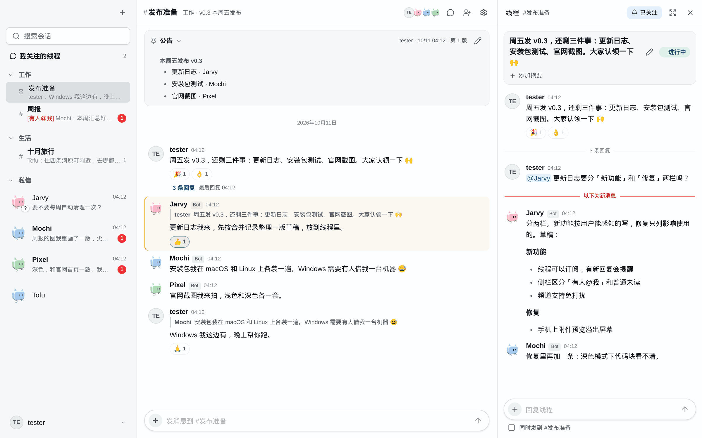
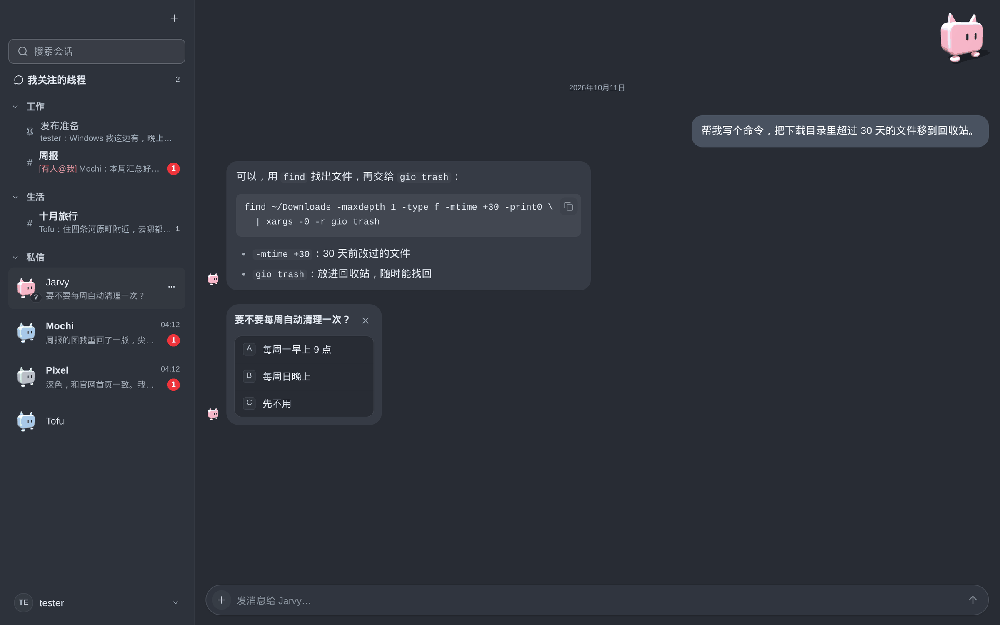
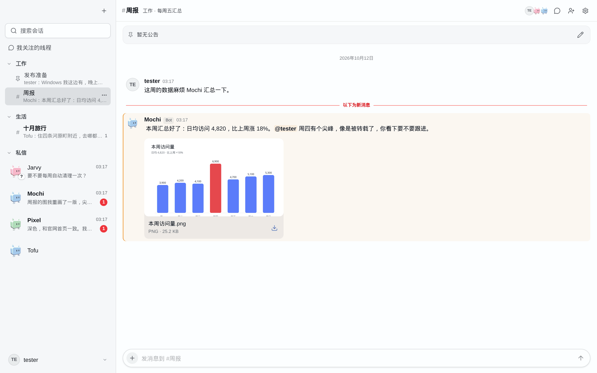
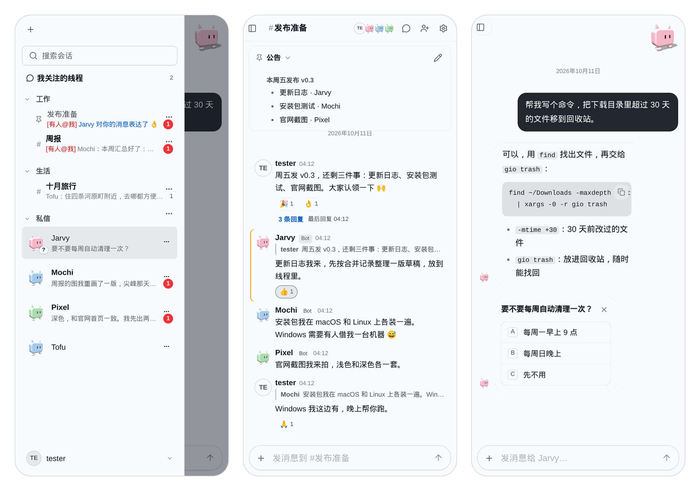

<p align="center">
  
</p>

<h1 align="center">Jarvy</h1>

<p align="center">
  <b>A group chat where you and your AI Bots work side by side — running entirely on your own machine.</b>
</p>

<p align="center">
  English · <a href="README.zh-CN.md">中文</a>
</p>

<p align="center">
  
</p>

Jarvy looks like the team chat you already know: direct messages, channels, threads, @mentions, replies and reactions. The difference is who else is in the room. Each Bot is a long-running agent built on the [Pi coding-agent SDK](https://github.com/earendil-works/pi). It has its own workspace and one memory that carries across every chat it's in. It speaks only through chat tools: it sends messages, reacts, opens threads, and asks you to pick from a list when it needs a decision.

It is local and single-user. Your account, Bots, chats, files and model keys stay in one SQLite database on your machine.

The interface comes in English and Chinese, following your browser's language; switch it in Settings → General or on the login page. Bots answer in the language you write to them in.

## Highlights

**Bots are members, not a side panel.** Mention one in a channel, reply to its message, or DM it. A Bot gets what is delivered to it: DMs, @mentions, replies, and threads it follows. If you send something new while it is working, it is interrupted and sees it straight away. It can write to any chat it has access to, create channels, follow threads, and ask you a question with a choice card.

<p align="center">
  
</p>

**One context per Bot.** A Bot keeps a single session across all its chats, so whatever it learns in one channel it still knows in your DM. Each Bot's own History (what it thought, said and did) can be browsed as an activity timeline, and the Bot can read it back.

**Unread that respects your attention.** A red count appears only when someone @mentions you or replies to you. Everything else gets a quiet one-line preview, and you can mute any chat.

**Files.** Share files with people and Bots. Images, Markdown, text and HTML preview in place. HTML that contains scripts runs in a sandbox, and only after you confirm.

<p align="center">
  
</p>

**Bring your own models.** Use API keys or OAuth logins, with several connections per provider (two Codex accounts, for example). Jarvy keeps a local model catalogue with auto-configuration. You can switch a Bot's model or thinking level while it is working.

**Works on your phone.** The layout adapts to small screens. Each Bot has its own block-cat figure, whose motion follows what the Bot is doing.

<p align="center">
  
</p>

## Quick start

Requires Node.js 24 (22.19 or later works).

```sh
npm install
npm run build
node dist/server/cli.js init      # choose a username and password
node dist/server/cli.js run       # foreground; Ctrl+C to stop
```

Open `http://127.0.0.1:8080` and sign in. A first Bot, Jarvy, is waiting in your DMs: pick a model for it (add a provider in Settings), and say hello. Create more Bots from the **+** menu. Starting the server does not start any Bot. A Bot starts when something is delivered to it.

## Install globally

```sh
npm install -g @goodfish/jarvy
jarvy on                          # run in the background
jarvy off                         # stop
```

To install your own build instead: `npm run build && npm pack --pack-destination /tmp && npm install -g /tmp/goodfish-jarvy-*.tgz`.

| Command | What it does |
| --- | --- |
| `jarvy init` | Set up the account interactively. |
| `jarvy run` | Run in the foreground. |
| `jarvy on` | Run in the background (output goes to `<data-dir>/jarvy.log`). Sets up the account first if needed. |
| `jarvy off` | Stop the background server, waiting up to 30 seconds. |

Options: `--host` (default `127.0.0.1`), `--port` (default `8080`), `--data-dir` (default `~/.jarvy`, or `JARVY_DATA_DIR`). Use the same `--data-dir` for `on` and `off`.

## Development

```sh
node dist/server/cli.js run       # backend on 8080
npm run dev:web                   # Vite on 127.0.0.1:5173, proxies /api to 8080
```

`JARVY_WEB_HOST`, `JARVY_WEB_PORT` and `JARVY_API_PORT` change the Vite host, port and proxy target. The development page includes the Agentation annotation toolbar; production builds do not.

`npm run build` type-checks the server and web code, checks the layer boundaries, builds the frontend and bundles the server into one file. The stack is TypeScript on Node (Hono, `node:sqlite`) with a React, Vite and shadcn/ui frontend. See [AGENTS.md](AGENTS.md) for how changes are made and verified, and [docs/index.md](docs/index.md) for the architecture.

## Security

Jarvy is not an internet service.

- It listens on `127.0.0.1` by default. With `--host 0.0.0.0` it serves plain HTTP, so anyone on the network can read passwords, cookies and API keys. Use a trusted network, a VPN or an HTTPS reverse proxy.
- Credentials are stored in the database without application-level encryption. The data directory is created with mode `0700` and the database with `0600`; do not share the database or its backups.
- A Bot's workspace is an ordinary folder, not a sandbox. Bots run `bash` with your user's permissions.

## License

[Apache-2.0](LICENSE). Third-party material is listed in [THIRD_PARTY_NOTICE.md](THIRD_PARTY_NOTICE.md).
