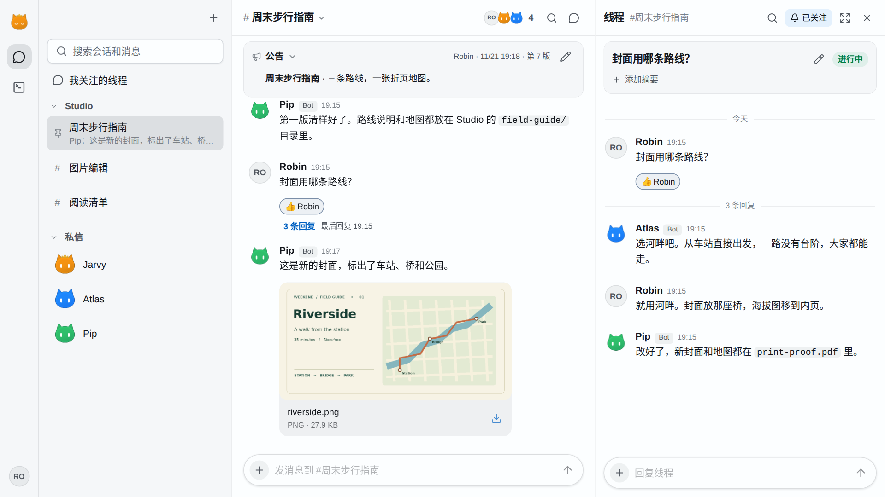
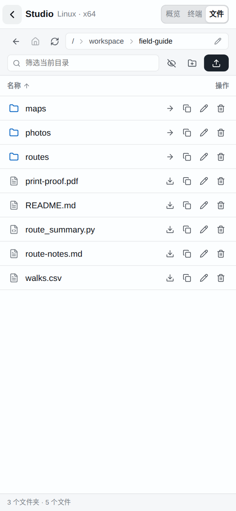

<p align="center">
  
</p>

<h1 align="center">Jarvy</h1>

<p align="center">
  <b>自托管的群聊式 AI 工作区，让你和常驻 AI Bot 像团队一样并肩协作。</b>
</p>

<p align="center"><a href="README.md">English</a> · 中文</p>

Jarvy 用起来像熟悉的团队群聊，区别在于群里的成员是拥有真实工作环境的常驻 AI Bot。在频道里把任务交给 Bot，在线程里敲定细节，再直接打开它干活的机器查看和操作成果。



## 系统架构

既可以在单机一键启动，也可以拆分为「轻量无状态控制面 + 端到端加密 S3 云存储 + 远程 Docker/KVM 算力池 + 零 Node 轻量化 `jarvy-agent` 主机」，所有节点均通过反向 WSS 安全接入：

<p align="center">
  <picture>
    <source media="(prefers-color-scheme: dark)" srcset="docs/images/zh/architecture-dark.svg">
    <source media="(prefers-color-scheme: light)" srcset="docs/images/zh/architecture-light.svg">
    
  </picture>
</p>

- **单机或无状态云端控制面**：`jarvy server` 默认使用本地 SQLite（`~/.jarvy`）；接入 S3 兼容对象存储（AWS S3 / Cloudflare R2 / MinIO / GCS）后自动启用客户端 AES-256-GCM 加密同步与单写者 Fencing Lease，轻量云服务器无需安装 Docker 或 KVM。
- **远程沙箱算力池**：在拥有 Docker 或 `/dev/kvm` 的内网/物理机上运行 `jarvy client start --sandbox`（或 `--sandbox-only` 关闭宿主机直连），即可按需调度隔离容器与完整 Linux 虚拟机，并通过预签名 URL 直连 S3 同步工作区，不消耗控制面带宽。
- **零 Node 轻量化主机（`jarvy-agent`）**：约 5.5 MB 的单文件 Go 静态二进制（支持 Linux / macOS / Windows），使用平台生成的一次性配对码免密接入，支持同机多用户独立登记与空闲自动更新。

## 在聊天里和 Bot 协作

- **组一个团队。** 告诉第一个 Bot「Jarvy」你想做什么，它会帮你创建其他 Bot、分工并配置模型。支持用 API Key 或 OAuth 接入你自己的模型账号，每个 Bot 都能单独指定模型和思考强度。
- **私信、频道、线程各司其职。** 小问题直接私信；需要协作的工作在频道里 @ 对应的 Bot；关心某个具体决策就关注它的线程。Bot 可以发送文件、弹选项卡片请你拍板，也能定时跟进。图片、文档、HTML 和音视频都能直接在聊天里预览或播放。
- **换个聊天，接着做。** 每个 Bot 在它参与的所有聊天里共用同一份上下文，从频道切到私信不必重头讲起。私信里的小猫会实时展示它正在做什么；想核对某条回复的依据，打开 History 就能看到背后的每次工具调用和结果。

## 直达 Bot 的工作环境

Bot 可以在专属的 Docker 容器或 Linux KVM 虚拟机（本机或远程算力节点）里工作，也能通过 `jarvy-agent`、SSH 连接远程主机，或接入桌面客户端配对的电脑。哪些 Bot 能用哪台机器，完全由你授权。Bot 在沙箱里跑起网页应用后，还可以发来一个登录后即可访问的预览链接。

打开**环境 → 终端**，可以在不同页签里同时运行并命名多个 shell。关闭网页或断网重连后，正在运行的进程和终端输出依然保留（仅在重启 Jarvy 服务时结束）。


切到**文件**页签，就能直接浏览目录、流式上传或下载文件、重命名和新建文件夹。传输直连工作环境，不会混进聊天记录；需要和团队一起看时，再作为消息附件发到聊天里。

<p align="center">
  
  
</p>

## 接入外部账号，由你授权

在**设置 → 连接器**里添加 GitHub、Gmail、Linear 或自定义 MCP 服务。Bot 申请的是某个具体连接（例如你的某一个 GitHub 账号），你可以选择「仅本次运行允许」或「长期允许」。开放连接并不等于放权修改：**每次写入操作仍会暂停并等待你单独确认**。

## 自托管，数据留在自己手里

Jarvy 面向单用户，完整运行在你掌控的机器上。聊天记录保存在 SQLite 中（可选端到端加密同步至 S3）；附件、Bot 工作区和会话文件分开存放；模型请求直接发往你配置的服务商。支持中英文界面，可通过电脑或手机浏览器访问，也可以下载 [Windows 或 Linux 桌面客户端](https://github.com/AzzzGoodFish/Jarvy/releases/latest)（支持系统托盘通知与一键更新重启）。

## 快速开始

需要 Node.js 24（22.19 及以上也可以）。Docker 可选：本机安装后即可直接运行沙箱，也可以通过 `jarvy client start --sandbox` 接入远程算力节点。

```sh
npm install
npm run build
node dist/server/cli.js server init   # 设置用户名和密码
node dist/server/cli.js server run    # 前台运行，Ctrl+C 停止
```

打开 `http://127.0.0.1:8080` 登录。私信里已经有第一个 Bot「Jarvy」：给它选好模型（在设置里添加服务商），它就会跟你打招呼，问你想做什么。更多 Bot 从 **+** 菜单新建。启动服务不会启动任何 Bot，有内容发给 Bot 时它才会开始工作。

## 全局安装

```sh
npm install -g @goodfish/jarvy
jarvy server start                     # 后台运行控制面服务
jarvy server stop                      # 优雅停止（自动完成云端最终同步）
jarvy client start --sandbox <url>     # 将另一台 Linux 机器接入为 Docker/KVM 算力节点
```

如果想把任意机器**零 Node 依赖**接入为远程主机，在 **环境 → 添加 → 桌面 / 主机** 一键生成带一次性配对码的安装命令即可，之后可用 `jarvy-agent on / off / status / logs / update` 管理。

想装自己构建的版本：`npm run build && npm run build:agent && npm pack --pack-destination /tmp && npm install -g /tmp/goodfish-jarvy-*.tgz`。

| 命令 | 作用 |
| --- | --- |
| `jarvy server init` | 交互式设置管理员账号。 |
| `jarvy server start` | 后台运行服务端（日志写入 `<data-dir>/jarvy.log`）。 |
| `jarvy server stop` | 优雅停止后台服务端（自动刷盘并同步云端快照）。 |
| `jarvy server run` | 前台运行服务端。 |
| `jarvy server status` | 查看服务端与云同步状态。 |
| `jarvy server backup` | 手动执行一次端到端加密 S3 备份。 |
| `jarvy server restore` | 从 S3 恢复数据目录与主密钥（`--storage`、`--recovery-key`）。 |
| `jarvy server update` | 检查更新或安装最新正式版（`--check`）。 |
| `jarvy server reset-2fa` | 本地应急关闭 TOTP 两步验证。 |
| `jarvy client login <url>` | 与 Jarvy 服务端配对（核对证书指纹、登录并保存凭证）。 |
| `jarvy client start [url]` | 后台运行客户端/算力节点（日志写入 `<config-dir>/client.log`）。 |
| `jarvy client stop` | 停止后台客户端节点（不中断运行中的沙箱/虚拟机）。 |
| `jarvy client run [url]` | 前台运行客户端节点。 |
| `jarvy client status` | 查看客户端连接状态。 |
| `jarvy client update` | 检查更新或安装最新客户端版本（`--check`）。 |
| `jarvy client logout` | 停止客户端并移除本地配对凭证。 |

服务端选项：`--host`（默认 `127.0.0.1`；其他地址自动在同端口提供 HTTPS）、`--port`（默认 `8080`）、`--data-dir`（默认 `~/.jarvy` 或 `JARVY_DATA_DIR`）、`--storage <s3://...>`、`--tls-only`（直接丢弃非 TLS 明文连接）、`--no-web`（主端口仅提供 API/WS，隐藏公网 Web 界面）、`--local-web-port <port>`（仅在 `127.0.0.1:<port>` 提供 Web UI 供 SSH 隧道/VPN 访问）、`--trust-proxy`。
客户端选项：`--name`（默认主机名）、`--config-dir`（默认 `~/.config/jarvy-client` 或 `JARVY_CLIENT_DIR`）、`--sandbox`、`--sandbox-only`（纯算力模式，关闭宿主机直连）、`--sandbox-image`、`--max-sandboxes`、`--idle-pause-min`、`--idle-reclaim-min`、`--no-auto-update`、`--reset`。

## 开发

```sh
node dist/server/cli.js server run  # 后端，端口 8080
npm run dev:web                     # Vite，127.0.0.1:5173，/api 代理到 8080
```

`JARVY_WEB_HOST`、`JARVY_WEB_PORT`、`JARVY_API_PORT` 分别修改 Vite 的地址、端口和代理目标。开发页面带 Agentation 标注工具栏，生产构建不包含。

`npm run build` 会对服务端和前端做类型检查、检查分层边界、构建前端并打包服务端（`npm run build:agent` 交叉编译 5 端 Go `jarvy-agent` 二进制）。技术栈：Node + TypeScript（Hono、`node:sqlite`）、Go（`jarvy-agent`）、React + Vite + shadcn/ui。开发约定与验证方式见 [AGENTS.md](AGENTS.md)，架构见 [docs/index.md](docs/index.md)。

## 安全

- **默认本机监听，也支持公网加固部署。** 默认仅监听 `127.0.0.1`。使用 `--host 0.0.0.0`（云主机可配 `JARVY_PUBLIC_HOST` 签发公网 IP/域名 SAN）时自动提供 TLS 1.2+ HTTPS 与 HSTS 并将明文 HTTP 跳转至 HTTPS；开启 `--tls-only` 可直接丢弃非 TLS 连接，开启 `--no-web`（可搭配 `--local-web-port 8080` 走 SSH 隧道）可彻底关闭公网 Web 暴露面。
- **身份认证与防爆破。** 可在**设置 → 安全**启用身份验证器 TOTP 两步验证（附带 8 个一次性恢复码），查看活跃会话与安全审计事件；登录受持久化单 IP + 全局双层防爆破与渐进延迟保护，安装脚本与二进制下载需凭有效会话、设备 Token 或一次性配对码。
- **静态与云端端到端加密。** 模型 API Key、密钥（**设置 → 密钥**）、TOTP 密钥和证书私钥均使用独立主密钥（`~/.config/jarvy/`，权限 `0600`）以 AES-256-GCM 加密保存；S3 云备份与工作区在离开本机前已完成客户端加密。
- **环境隔离。** Bot 默认在自己的沙箱里工作，沙箱间网络隔离；Bot 发布的预览端口（默认 `12600–12699`）需登录后访问，且 Jarvy 登录 Cookie 不会转发给 Bot 应用。

## 许可证

[Apache-2.0](LICENSE)。第三方材料见 [THIRD_PARTY_NOTICE.md](THIRD_PARTY_NOTICE.md)。
