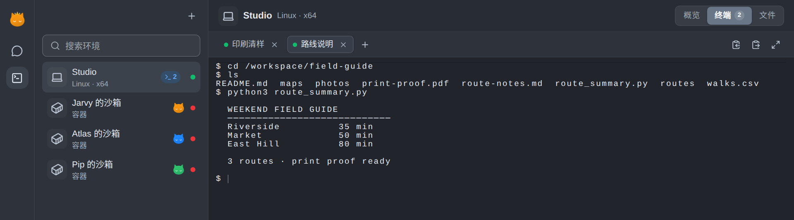
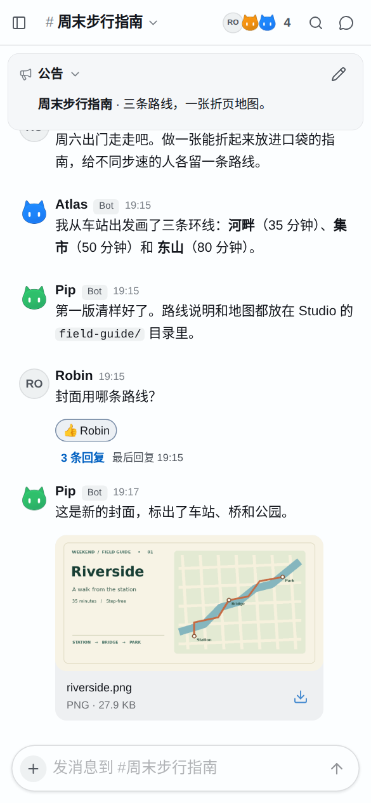

<p align="center">
  
</p>

<h1 align="center">Jarvy</h1>

<p align="center">
  <b>自托管的群聊式 AI 工作区 — 让常驻 Bot 拥有真实沙箱、交互终端与端到端加密同步。</b>
</p>

<p align="center">
  <a href="README.md">English</a> · 中文 · <a href="https://github.com/AzzzGoodFish/Jarvy/releases/latest">桌面客户端</a> · <a href="docs/index.md">架构文档</a>
</p>


## 架构与流转

既可单机启动，也可拆分为无状态控制面、远程 Docker/KVM 算力池、零 Node `jarvy-agent` 主机与端到端加密 S3：

<p align="center">
  <picture>
    <source media="(prefers-color-scheme: dark)" srcset="docs/images/zh/architecture-dark.svg">
    <source media="(prefers-color-scheme: light)" srcset="docs/images/zh/architecture-light.svg">
    
  </picture>
</p>

- **无状态控制面（`jarvy server`）** — 默认本地 SQLite，接入 S3 自动启用客户端 AES-256-GCM 加密同步与单写者租约。
- **远程算力池（`jarvy client --sandbox`）** — 反向 WSS 按需调度 Docker 容器与 KVM 虚拟机，预签名直传工作区到 S3。
- **轻量远程主机（`jarvy-agent`）** — ~5.5 MB 单文件 Go 二进制（Linux / macOS / Windows），一次性配对码免密接入。

## 核心特性

- **像团队一样和常驻 Bot 协作** — 私信、频道、线程与跨聊天共享上下文，实时状态头像、选项卡片、定时任务及完整工具调用 History。
- **直达每个工作环境** — 持久多页签终端、直连文件浏览与上传下载、登录保护的网页预览，以及按 Bot 细粒度授权。
- **可控的外部账号与 MCP** — 接入 GitHub、Gmail、Linear 或自定义 MCP；**所有写入操作均会暂停等待你的确认**。
- **自托管、全端可用** — 中英文 Web / PWA，以及支持托盘通知和一键在线升级的 [Windows / Linux 桌面客户端](https://github.com/AzzzGoodFish/Jarvy/releases/latest)。



<p align="center">
  
  
</p>

## 快速开始

需要 Node.js 24（22.19+ 可用），Docker 可选。

```sh
npm install -g @goodfish/jarvy
jarvy server init                      # 初始化管理员用户名与密码
jarvy server start                     # 后台启动控制面（http://127.0.0.1:8080）
jarvy client start --sandbox <url>     # 可选：接入远程 Docker/KVM 算力节点
```

打开 `http://127.0.0.1:8080`，在 **设置** 中添加模型服务商，即可和第一个 Bot（**Jarvy**）开始对话。如需接入无 Node 的远程主机，在 **环境 → 添加 → 桌面 / 主机** 复制一次性 `jarvy-agent` 配对命令即可。

<details>
<summary><b>CLI 命令与常用选项</b></summary>

| 命令 | 说明 |
| --- | --- |
| `jarvy server init` | 交互式设置管理员账号。 |
| `jarvy server start` / `stop` / `run` | 启动或优雅停止服务端（自动完成云端最终同步）。 |
| `jarvy server status` / `update` | 查看运行与云同步状态，或检查/升级版本（`--check`）。 |
| `jarvy server backup` / `restore` | 手动执行加密 S3 备份或恢复（`--storage`、`--recovery-key`）。 |
| `jarvy server reset-2fa` | 本地应急关闭 TOTP 两步验证。 |
| `jarvy client login <url>` / `logout` | 配对或解绑算力节点（含 TLS 证书指纹校验）。 |
| `jarvy client start` / `stop` / `run` | 启动或停止算力节点（不中断运行中的沙箱/虚拟机）。 |
| `jarvy client status` / `update` | 查看节点状态或升级客户端版本（`--check`）。 |
| `jarvy-agent on` / `off` / `status` / `logs` / `update` | 管理零 Node Go 轻量主机代理。 |

**服务端选项：** `--host`（默认 `127.0.0.1`；其他地址自动启用 HTTPS）、`--port`（`8080`）、`--data-dir`（`~/.jarvy` / `JARVY_DATA_DIR`）、`--storage <s3://...>`、`--tls-only`、`--no-web`、`--local-web-port <port>`、`--trust-proxy`。

**客户端选项：** `--name`、`--config-dir`（`~/.config/jarvy-client` / `JARVY_CLIENT_DIR`）、`--sandbox`、`--sandbox-only`、`--sandbox-image`、`--max-sandboxes`、`--idle-pause-min`、`--idle-reclaim-min`、`--no-auto-update`、`--reset`。

</details>

<details>
<summary><b>源码构建与本地开发</b></summary>

```sh
npm install && npm run build
node dist/server/cli.js server init
node dist/server/cli.js server run     # 后端运行在 8080
npm run dev:web                        # Vite 运行在 127.0.0.1:5173（代理 /api 到 8080）
```

- `npm run build` 会执行前后端类型检查、架构边界检查与打包（`npm run build:agent` 交叉编译 5 端 Go `jarvy-agent`）。
- 技术栈：Node + TypeScript（Hono、`node:sqlite`）、Go（`jarvy-agent`）、React + Vite + shadcn/ui。
- 开发规范见 [AGENTS.md](AGENTS.md)，架构设计见 [docs/index.md](docs/index.md)。

</details>

<details>
<summary><b>安全与隔离机制</b></summary>

- **公网加固部署：** 默认仅监听 `127.0.0.1`；`--host 0.0.0.0` 自动启用 TLS 1.2+ HTTPS 与 HSTS（云主机支持 `JARVY_PUBLIC_HOST`），配合 `--tls-only` 与 `--no-web --local-web-port 8080` 可彻底隐藏公网 Web 暴露面。
- **身份认证与防爆破：** 支持 TOTP 两步验证（8 个恢复码）、活跃会话与审计日志、单 IP + 全局双层限流，安装包与二进制下载受令牌保护。
- **端到端零明文加密：** API Key、密钥、TOTP 与证书私钥使用独立主密钥（`~/.config/jarvy/`，`0600`）以 AES-256-GCM 封装；S3 快照与工作区均在离开本机前加密。
- **沙箱隔离：** 沙箱间网络隔离；预览端口（`12600–12699`）需登录 Jarvy 访问且不向 Bot 应用透传登录 Cookie。

</details>

## 许可证

[Apache-2.0](LICENSE) · 第三方声明见 [THIRD_PARTY_NOTICE.md](THIRD_PARTY_NOTICE.md)。
